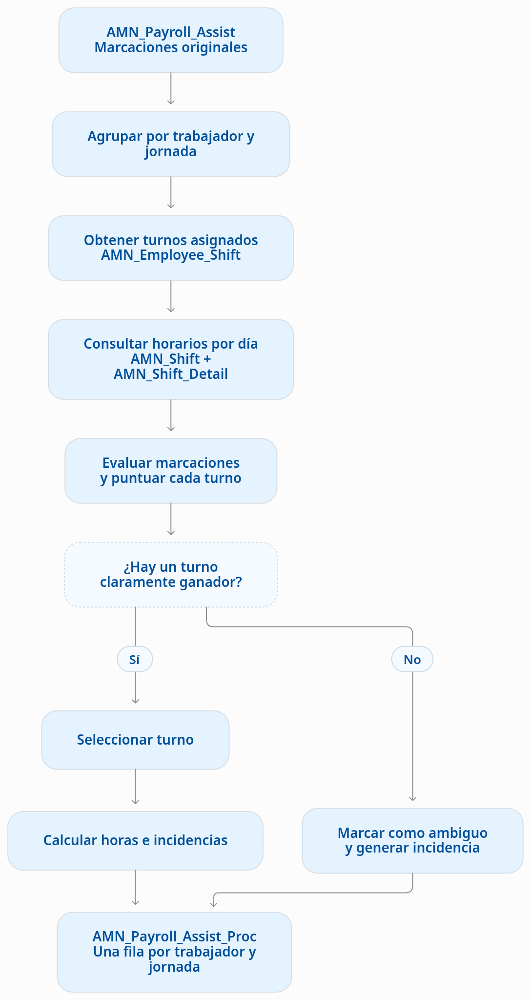

# AMNPayrollProcessPayrollAsist

Para tu proceso de asistencia en iDempiere, donde trabajas con turnos por día de la semana y marcaciones de tipo `AMN_Payroll_Assist`, te recomiendo un algoritmo basado en intervalos de trabajo planificados y marcaciones reales, con reglas diferentes según el tipo de jornada del trabajador.

La clave es no comparar cada marcación directamente con un horario fijo. Primero hay que determinar qué jornada tenía asignada el trabajador y después interpretar sus marcaciones. Así evitas contabilizar como ausencias las salidas esporádicas de los trabajadores flexibles y puedes procesar correctamente tanto a quienes marcan dos veces como a quienes marcan cuatro o más.

| Indice | Link                                     | Comments                                              |
| -----: | ---------------------------------------- | ----------------------------------------------------- |
|      1 | [Conceptos previos](step1)               | Dabase machine                                        |
|      2 | [Limpieza](step2)                        | Criterios de Limpieza previa                          |
|      3 | [Planificación/Interpretación](step3)  | Separar planificación/interpretación de marcaciones |
|      4 | [Definir turnos ](step4)                 | Representar cada turno como intervalos de trabajo     |
|      5 | [Estrategia de interprestación ](step5) | Estrategias para interpretar las marcaciones          |
|      6 | [Resolver ](step6)                       | Resolver las marcaciones según su cantidad           |
|      7 | [Algoritmo ](step7)                      | Algoritmo que implementaría en Java                  |

## <a name="step1"></a>1-⭐️ Conceptos previos

En tu sistema de asistencia por turnos, los conceptos «**Flexible**», «**Límite de tiempo de entrada**» y «**Flotante**» podrían representar parámetros distintos para controlar la flexibilidad horaria.

### Horas por día en un turno

Determina el número de horas diarias por jornada. Normalmente se toma 8.
Para trabajadores de Seguridad puede ser 12.

### Horas de trabajo por Semana

Determina el número de horas semanales. Usualmente pueden ser 48 y 72 para trabajadores de vigilancia.

### Flexible

El check Flexible como un indicador que determina si la asistencia del trabajador se calcula por las horas efectivamente trabajadas o por el cumplimiento de horarios concretos.

Indica que el trabajador dispone de flexibilidad horaria y que el cálculo de asistencia no debe generar ausencias o retrasos únicamente porque sus marcaciones no coincidan con las horas exactas del turno asignado.

- <b>Ejemplo práctico</b>

Un trabajador tiene asignadas 8 horas diarias y registra las siguientes marcaciones:

| Marcación     | Hora  |
| -------------- | ----- |
| Entrada        | 08:15 |
| Salida         | 10:30 |
| Regreso        | 10:45 |
| Salida a comer | 13:00 |
| Regreso        | 14:00 |
| Salida final   | 17:30 |

Con el check Flexible activado:

- Se calculan los intervalos de trabajo registrados.
- Las salidas intermedias no se consideran automáticamente ausencias injustificadas.
- Se suman las horas efectivas y se comparan con las 8 horas exigidas.
- Si faltan marcaciones, se genera una incidencia o se aplica la regla de recuperación configurada.

Con el check desactivado, el sistema podría aplicar el horario fijo asignado y evaluar retrasos, salidas anticipadas y ausencias respecto a sus intervalos previstos.

Mi recomendación de diseño: mantener `Flexible` independiente de `Límite de tiempo de entrada`. El primero define cómo se evalúa la jornada; el segundo determina el margen de tolerancia de entrada. Así puedes tener un trabajador con horario fijo y tolerancia de 10 minutos, o uno flexible que no se evalúa por puntualidad, pero sí debe cumplir sus horas diarias.

### Límite de tiempo de entrada

Es el margen permitido respecto a la hora de entrada planificada antes de generar una incidencia por retraso.

Ejemplo: entrada prevista a las 08:00.

| Parámetro         | Resultado                                                   |
| ------------------ | ----------------------------------------------------------- |
| Límite: 5 minutos | Entrada a las 08:04: dentro del margen.                     |
| Límite: 5 minutos | Entrada a las 08:05: en el límite permitido.               |
| Límite: 5 minutos | Entrada a las 08:08: retraso de 3 minutos fuera del margen. |

Conviene distinguir entre el margen de tolerancia y el retraso contabilizable. En el ejemplo, si el margen es de 5 minutos, podrías contabilizar únicamente los 3 minutos que exceden ese margen, según la política de la empresa.

También habría que definir si el límite se aplica a la primera entrada del día o a cada entrada de los distintos turnos.

### Flotante

En el contexto de los turnos, podría tener dos significados.

Opción A. Horario flotante

El trabajador puede entrar y salir en horarios variables dentro de ciertos límites. El sistema controla principalmente las horas trabajadas, en lugar de exigir que cada marcación coincida con el horario previsto.

Ejemplo: jornada de 8 horas con entrada entre las 07:00 y las 10:00.

Opción B. Turno flotante

El trabajador no tiene un turno fijo asignado a una hora concreta, o su horario puede variar según las necesidades del servicio. El sistema necesita reglas especiales para determinar qué jornada corresponde a cada fecha.

### Multiples turnos

Cunado un trabajado dispone de diferentes turnos y no existe planificación que permita al sistema determinar con precisión el turno a aplicar, se procede a utilizar un algoritmo que determine el turno que mas se adecúa a las marcaciones hechas, segun un criterio de puntos. Se explica en detalle en capítulo de Algoritmo de determinación de turno.

## <a name="step2"></a>2-⭐️ Tablas de Registros y Criterios de Limpieza previa

Tablas relacionadas con lor registros de marcaciones y asistencia de los trbajadores:

| Tabla                   | Descripcion                           | Orígen de registros                                            |
| ----------------------- | ------------------------------------- | --------------------------------------------------------------- |
| AMN_Payroll_Assist_Row  | Registro de eventos relojes           | Proceso ETL, transfiere relojes a Tabla                         |
| AMN_Payroll_Assist      | Registro de eventos de marcaciones    | Proceso importación de AMN_Payroll_Assist_Row                  |
| AMN_Payroll_Assist_Proc | Registro de asistencia real procesada | Proceso de asistencia. Calculos de Horas trabajadas y ausencias |

La limpieza de marcaciones falsas como una fase previa al cálculo de asistencia. Su objetivo es identificar registros duplicados, erróneos o incompatibles, sin eliminar marcaciones válidas que correspondan a salidas esporádicas de trabajadores con horario flexible.

La regla principal sería: limpiar los errores demostrables, pero no eliminar marcaciones solo porque no encajen con el turno asignado.

### Criterios de limpieza recomendados

| Criterio                                     | Ejemplo                                          | Acción                                                                                 | Nota        |
| -------------------------------------------- | ------------------------------------------------ | --------------------------------------------------------------------------------------- | ----------- |
| Duplicados exactos                           | Dos entradas a las 08:00:00 del mismo trabajador | Conservar una si son duplicados técnicos.                                              |             |
| Marcaciones casi simultáneas                | Entrada a las 08:00:01 y 08:00:03                | Evaluar una ventana configurable; no eliminar automáticamente sin verificar su origen. |             |
| Secuencia imposible                          | Dos entradas consecutivas sin salida intermedia  | Marcar como posible anomalía y reconstruir solo si existe evidencia suficiente.        | No se puede |
| Marcaciones fuera del período               | Registro asignado al día incorrecto             | Revisar la fecha y el turno, especialmente si cruza medianoche.                         |             |
| Marcaciones incompatibles con el dispositivo | Registro de prueba o evento técnico             | Excluir únicamente si el tipo de evento permite identificarlo con certeza.             |             |
| Entrada o salida aislada                     | Solo una marcación en todo el día              | Conservar y generar incidencia por jornada incompleta.                                  |             |
| Salidas intermedias                          | Entrada, salida, regreso y nueva salida          | Conservar en trabajadores flexibles; no son falsas por sí mismas.                      |             |

### Reglas según el intervalo entre marcaciones

Conviene configurar una tolerancia para detectar duplicados temporales. Por ejemplo, una ventana inicial de 30 segundos puede servir para detectar posibles duplicados, pero no debe ser una regla universal.

* Duplicado exacto

Mismo trabajador, instante, tipo de evento y origen técnico. Se puede conservar un registro y marcar el otro como duplicado.

* Marcaciones cercanas

Dos registros separados por pocos segundos pueden representar una repetición accidental, pero también eventos diferentes. Se deben comparar el tipo, el dispositivo y el identificador de origen.

* Marcaciones válidas fuera de horario

Una entrada temprana, una salida tardía o una salida intermedia no deben eliminarse por estar fuera del turno previsto.

* Limpieza de secuencias de marcaciones

Una vez identificados los duplicados, analizaría la secuencia cronológica del trabajador.

Por ejemplo, para una jornada ordinaria:

`08:00 Entrada → 12:00 Salida → 13:00 Entrada → 17:00 Salida`

Esta secuencia es coherente.

En cambio:

`08:00 Entrada → 08:01 Entrada → 12:00 Salida → 13:00 Entrada → 17:00 Salida`

La segunda entrada de las 08:01 es sospechosa, pero no necesariamente falsa. Si el sistema no registra el tipo de evento y solo almacena la hora, conviene marcar la secuencia para su interpretación, no borrar el registro automáticamente.

Para trabajadores flexibles, las secuencias con más de cuatro marcaciones deben ser admisibles. La cantidad de fichajes no debe ser el criterio principal de limpieza.

### Algoritmo propuesto

Implementar la limpieza en este orden:

1. Normalización: convertir las fechas y horas a una referencia cronológica consistente.
2. Duplicados exactos: detectar repeticiones del mismo evento.
3. Duplicados probables: detectar marcaciones próximas y contrastar su origen.
4. Validación cronológica: detectar secuencias anómalas sin asumir que son falsas.
5. Clasificación: separar marcaciones válidas, duplicados confirmados y anomalías pendientes.
6. Cálculo de asistencia: utilizar las marcaciones aceptadas, conservando las incidencias que requieran revisión.

No haría una eliminación física de los registros originales. Guardaría el resultado de la limpieza, el motivo, la fecha de procesamiento y la referencia a la marcación original. Así se puede auditar y corregir el cálculo de nómina.

### Parámetros que configuraría en Amerpsoft

| Parámetro                                 | Propuesta inicial                                              |
| ------------------------------------------ | -------------------------------------------------------------- |
| Ventana de duplicados probables            | 30 segundos, configurable                                      |
| Eliminación de duplicados exactos         | Sí, si se confirma que son el mismo evento. 300 segundos      |
| Eliminación de marcaciones fuera de turno | No                                                             |
| Eliminación de jornadas incompletas       | No                                                             |
| Admisión de más de cuatro marcaciones    | Sí                                                            |
| Conservación de registros originales      | Siempre. <br />AMN_PAyroll_Assist<br />AMN_Payroll_Assist_Proc |
| Revisión de anomalías ambiguas           | Sí                                                            |

Los 30 segundos son un valor inicial para pruebas, no un estándar universal. Debe ajustarse según el dispositivo de fichaje y la forma en que se generan las marcaciones.

### Mi recomendación para tu método Java

Separaría la limpieza de la interpretación de la jornada:

- `cleanAttendancePunches(...)`: detecta duplicados y anomalías.
- `calculateAttendance(...)`: interpreta los registros válidos según los turnos y el check `Flexible`.
- `validateAttendanceResult(...)`: comprueba que el resultado no tenga inconsistencias.

De esta forma, una marcación no se elimina simplemente porque no encaje con el horario, y la lógica de limpieza no depende de si el trabajador tiene dos, cuatro o más fichajes.

Una cuestión importante para concretar el algoritmo: ¿la tabla `AMN_Payroll_Assist` almacena solamente la fecha y hora de la marcación, o también distingue el tipo de evento —entrada o salida— y el dispositivo que la generó? Esa información cambia significativamente la fiabilidad con la que podemos identificar marcaciones falsas.

## <a name="step3"></a>3-⭐️ Separar la planificación de la interpretación de las marcaciones

1\. Turnos asignados al trabajador

Fecha, día de la semana, turnos, horarios y tipo de jornada

2\. Normalizar las marcaciones

Ordenar por fecha y hora, validar duplicados y resolver cruces de medianoche

3\. Clasificar la jornada

Rígida, flexible o sin horario completo; identificar si se esperan 2, 4 o más marcaciones

4\. Calcular los tiempos

Trabajo efectivo, pausas, retrasos, salidas anticipadas y ausencias justificadas o pendientes de revisar

5\. Generar el resultado de asistencia

Totales diarios, incidencias y detalle auditable de cada cálculo

Mi recomendación es que cada etapa tenga una responsabilidad concreta. No conviene resolver la asignación de turnos, la interpretación de marcaciones y el cálculo de ausencias dentro de un único método con muchos condicionales.

## <a name="step4"></a>4-⭐️ Representar cada turno como intervalos de trabajo

Un turno convencional tiene cuatro horas relevantes:

| Concepto         | Ejemplo |
| ---------------- | ------- |
| Entrada          | 08:00   |
| Salida a comer   | 12:00   |
| Regreso de comer | 13:00   |
| Salida a casa    | 17:00   |

Esto representa dos intervalos planificados:

- Trabajo de mañana: 08:00–12:00.
- Trabajo de tarde: 13:00–17:00.

Si el trabajador tiene varios turnos asignados para el mismo día, debes obtener todos los intervalos correspondientes a esa fecha y unirlos en una planificación diaria coherente. También hay que detectar solapamientos entre turnos para no contabilizar dos veces el mismo tiempo.

Importante: el turno planificado no tiene que coincidir necesariamente con la estructura de las marcaciones. Una persona puede trabajar durante los dos intervalos previstos y registrar solo entrada y salida al final de la jornada.

## <a name="step5"></a>5-⭐️ Tres estrategias para interpretar las marcaciones

No usaría un algoritmo distinto para cada cantidad de marcaciones. Utilizaría un mismo motor de cálculo con distintas reglas según el tipo de jornada y la evidencia disponible.

A. Jornada rígida

El trabajador tiene un horario que debe cumplir. Se compara la primera entrada y la última salida con el horario y se analizan las marcaciones intermedias para determinar pausas, retrasos y salidas anticipadas.

Adecuado para trabajadores con turnos fijos.

B. Jornada flexible

Se calcula el tiempo de presencia y, cuando existen marcaciones suficientes, los intervalos de trabajo y las salidas. Las salidas esporádicas no se consideran automáticamente ausencias injustificadas.

Si existe una obligación de cumplir horas diarias, se compara el total efectivo con las horas exigidas, no con cada intervalo fijo del turno.

Adecuado para trabajadores con entradas y salidas variables.

C. Jornada con dos marcaciones

La primera marca la entrada y la segunda la salida. El sistema calcula el tiempo transcurrido y aplica la regla de descanso correspondiente al turno.

Si el descanso no está registrado, debe tratarse como un descanso supuesto conforme a la política aplicable, no como un dato real conocido.

Adecuado para trabajadores que solo fichan al comenzar y terminar.

Este enfoque es coherente con los sistemas de control horario que interpretan las marcaciones según el turno, las ventanas horarias y las reglas de pausas, en lugar de asignar un significado fijo a cada fichaje.&#x20;

[image](https://www.google.com/s2/favicons?domain=https://sso-hlp01.gss.mykronos.com\&sz=32)

sso-hlp01.gss.mykronos.com

+1

## <a name="step6"></a>6-⭐️ Cómo resolver las marcaciones según su cantidad

Supongamos una jornada planificada de 08:00 a 17:00, con comida de 12:00 a 13:00.

| Marcaciones                                 | Interpretación recomendada                                                                  |
| ------------------------------------------- | -------------------------------------------------------------------------------------------- |
| 2: 08:00, 17:00                             | Presencia de 9 h; descontar la comida según la política configurada.                       |
| 4: 08:00, 12:00, 13:00, 17:00               | Dos intervalos de trabajo registrados; total efectivo de 8 h.                                |
| 6: 08:00, 10:00, 10:15, 12:00, 13:00, 17:00 | Dos salidas intermedias adicionales; analizar cada intervalo según la política de jornada. |
| 3: 08:00, 12:00, 17:00                      | Hay una marcación sin pareja; el día requiere una regla de recuperación o revisión.      |
| 1: 08:00                                    | Jornada incompleta; no inventar la hora de salida.                                           |

En el caso de seis marcaciones, por ejemplo, no debes considerar que las 10:00–10:15 son una ausencia injustificada simplemente porque no coinciden con la comida. Primero debes comprobar si el trabajador tiene jornada flexible o si esa salida está autorizada.

### Una regla importante

Dos marcaciones no demuestran por sí solas que el trabajador haya trabajado todas las horas previstas. Solo permiten conocer la entrada y salida registradas. El tiempo efectivo calculado dependerá de la política de descansos, las autorizaciones y el grado de confianza que se permita al registro.

### <a name="step7"></a>Algoritmo que implementaría en Java

Para tu caso, dividiría el proceso en cinco métodos, sin duplicar toda la lógica para dos, cuatro o más marcaciones.

```

public AttendanceResult processAttendance(
        M_Employee employee,
        Timestamp workDate,
        List<AMN_Payroll_Assist> assists) {

    // 1. Obtener todos los turnos aplicables a la fecha.
    List<WorkInterval> plannedIntervals =
        getPlannedIntervals(employee, workDate);

    // 2. Normalizar las marcaciones reales.
    List<Punch> punches =
        normalizePunches(assists, workDate);

    // 3. Determinar las reglas de la jornada.
    AttendancePolicy policy =
        getAttendancePolicy(employee, plannedIntervals);

    // 4. Interpretar las marcaciones según la política.
    AttendanceResult result =
        calculateAttendance(
            plannedIntervals,
            punches,
            policy
        );

    // 5. Registrar resultados e incidencias.
    return validateAndFinalize(result, policy);
}
```

Los tipos `WorkInterval`, `Punch`, `AttendancePolicy` y `AttendanceResult` son clases propuestas para el diseño; no son necesariamente clases existentes en iDempiere.

Los métodos auxiliares tendrían estas responsabilidades:

- `getPlannedIntervals`: obtiene los turnos correspondientes al día de la semana y a la fecha efectiva.
- `normalizePunches`: ordena las marcaciones cronológicamente, elimina duplicados técnicos cuando corresponda y resuelve jornadas que cruzan medianoche.
- `getAttendancePolicy`: identifica si la jornada es rígida o flexible, las horas obligatorias y las reglas de descanso.
- `calculateAttendance`: construye los intervalos de trabajo reales y calcula tiempos e incidencias.
- `validateAndFinalize`: detecta marcaciones sin pareja, turnos solapados y resultados que requieren revisión.

### La decisión más importante: no confundir ausencia con falta de marcación

Yo manejaría al menos cuatro resultados independientes:

| Resultado            | Significado                                                                              |
| -------------------- | ---------------------------------------------------------------------------------------- |
| Tiempo trabajado     | Tiempo efectivo calculado a partir de los registros disponibles y las reglas aplicables. |
| Tiempo no trabajado  | Intervalo en el que no se acredita trabajo, sujeto a las reglas de la jornada.           |
| Incidencia pendiente | Falta una marcación o hay datos insuficientes para decidir.                             |
| Ausencia confirmada  | Ausencia determinada después de aplicar las reglas y las autorizaciones pertinentes.    |

Esto evita que el sistema descuente automáticamente tiempo por una salida sin clasificar o porque falte una marcación. Las incidencias deben conservar el motivo, los datos de origen y cualquier corrección aprobada.

## 7. Qué necesito definir antes de concretar el algoritmo

Hay una decisión de negocio que determina casi todo el diseño: qué debe ocurrir cuando un trabajador flexible sale y vuelve varias veces durante el día.

1\. ¿Cómo controlas la jornada flexible?

Solo debe cumplir un número de horas diarias.

Debe cumplir las horas y respetar los intervalos del turno.

Solo quiero registrar presencia y salidas, sin calcular ausencias por cada salida.

2\. Cuando hay solo dos marcaciones, ¿cómo tratas la comida?

Descontar automáticamente la duración prevista de la comida.

No descontar nada; toda la presencia cuenta inicialmente como tiempo computable.

Aplicar una regla configurable según el turno y revisar los casos dudosos.

3\. Si falta una marcación intermedia, ¿qué debería hacer el sistema?

Generar una incidencia para revisar, sin descontar automáticamente.

Intentar reconstruir la jornada a partir del turno y las marcaciones disponibles.

Aplicar una regla estricta y calcular el tiempo no acreditado.

4\. Si hay varios turnos el mismo día, ¿cómo se deben tratar?

Como una jornada diaria conjunta, sumando los intervalos planificados.

Como jornadas separadas, asignando las marcaciones a cada turno.

Diseñar el algoritmo con estas reglas

Con esas decisiones podemos construir un algoritmo robusto, compatible con tu modelo de `AMN_Payroll_Assist`, sin multiplicar los métodos por cada caso de marcaciones y evitando que las salidas legítimas se conviertan en ausencias ficticias.

## 8-⭐️Regla para determinar el turno.

Utilizar un algoritmo de inferencia del turno a partir de las marcaciones reales, sin necesidad de introducir una planificación diaria.

De hecho, si el trabajador puede tener varios turnos asignados y realizar diferentes jornadas durante el período, esta puede ser una solución práctica. Pero hay una condición importante: el algoritmo debe distinguir entre el turno que mejor explica las marcaciones y el turno que realmente se había asignado al trabajador ese día.

La idea es utilizar los turnos asignados como candidatos y comparar sus horarios con las marcaciones de cada jornada.

La relación principal queda así:

### `AMN_Employee`

Trabajador

### `AMN_Employee_Shift`

Turnos asignados al trabajador

### `AMN_Shift`

Definición del turno

### `AMN_Shift_Detail`

Horarios y reglas por día de la semana

Las marcaciones de `AMN_Payroll_Assist` se utilizan para identificar el turno que mejor encaja con la jornada. Después, el resultado se guarda en la tabla de asistencia procesada, junto con el turno seleccionado.

### Algoritmo definitivo propuesto

1. Obtener el trabajador y sus turnos asignados desde `AMN_Employee_Shift`.
2. Consultar los detalles de esos turnos en `AMN_Shift_Detail` para el día de la semana de `Event_Date`.
3. Agrupar y normalizar las marcaciones brutas del trabajador.
4. Comparar cada turno candidato con las marcaciones.
5. Seleccionar el turno con mejor puntuación si la diferencia es suficientemente clara.
6. Aplicar el cálculo de asistencia correspondiente, respetando la configuración `Flexible` y el límite de tiempo de entrada.
7. Guardar el resultado procesado y registrar las incidencias o ambigüedades.

Si un trabajador tiene un único turno aplicable ese día, podremos seleccionarlo directamente, siempre que la asignación represente el turno esperado. Si hay varios, utilizaremos la inferencia.

### Diseño del algoritmo de selección automática de turnos

Implementar la selección automática en Java dentro del proceso de nómina Amerpsoft, reutilizando

 `AMN_Payroll_Assist`, `AMN_Employee_Shift`, `AMN_Shift`, `AMN_Shift_Detail` y `AMN_Payroll_Assist_Proc`.

La regla principal será: seleccionar el turno que mejor explique las marcaciones del trabajador para esa jornada, sin asumir que `event_type` identifica una entrada o salida y sin modificar las marcaciones originales.

#### 1. Reglas de diseño

- Una fila procesada por trabajador y jornada en `AMN_Payroll_Assist_Proc`.
- Las marcaciones se ordenan cronológicamente por `event_time`; si este campo es nulo, se debe tratar como un dato incompleto, no sustituirlo silenciosamente por `event_date`.
- `dayofweek` utiliza valores del 1 al 7. Debemos confirmar que el valor 1 corresponde al lunes o al domingo según cómo se haya generado en la aplicación. PostgreSQL, por ejemplo, usa `EXTRACT(ISODOW ...)` para lunes = 1 y domingo = 7; `EXTRACT(DOW ...)` usa domingo = 0 y sábado = 6.
- El turno debe pertenecer al trabajador, estar activo y encontrarse dentro de su vigencia.
- Los horarios se obtienen de `AMN_Shift_Detail` para el día correspondiente.
- Los turnos flexibles se evalúan con menos peso en la coincidencia exacta de entrada y salida.
- Si dos turnos tienen puntuaciones demasiado próximas, el resultado será ambiguo y no se asignará automáticamente un turno arbitrario.
- Las marcaciones originales se conservan intactas.

#### 2. Algoritmo propuesto

A. Cargar las marcaciones

Trabajador + fecha de jornada

B. Obtener los turnos candidatos

Asignación del trabajador + turno activo + detalle del día

C. Puntuar cada candidato

Entrada, salida final, pausa, duración y flexibilidad

D. Resolver la selección

Mejor candidato claro → seleccionado; empate → ambiguo

E. Calcular y persistir

Una fila procesada por trabajador y jornada

##### Cómo tratar las marcaciones

| Cantidad  | Tratamiento inicial                                                                                                        |
| --------- | -------------------------------------------------------------------------------------------------------------------------- |
| 2         | Comparar primera marcación con entrada prevista y última con salida prevista. No asumir que existe una pausa registrada. |
| 3         | Comparar las marcas interiores con las posibles salidas y entradas intermedias; dejar constancia de la incertidumbre.      |
| 4         | Comparar con los cuatro horarios del turno, si los cuatro están definidos.                                                |
| Más de 4 | Evaluar las marcas interiores adicionales sin eliminarlas ni considerarlas automáticamente anomalías.                    |

Como `event_type` no permite distinguir de forma fiable entradas y salidas, utilizaremos inicialmente el orden cronológico. Esto sirve para estimar el turno, pero no basta para clasificar con certeza cada marcación ni para determinar todas las incidencias.

#### 3. Método Java para seleccionar el turno

La siguiente implementación es el núcleo de la selección. Está pensada para Java 17 y separa la puntuación del acceso a la base de datos. La consulta de candidatos se conecta después con las tablas reales del ERP.

Primero definimos los datos que necesita el evaluador:

```
import java.time.Duration;
import java.time.LocalDate;
import java.time.LocalDateTime;
import java.time.LocalTime;
import java.util.ArrayList;
import java.util.Comparator;
import java.util.List;

public class ShiftSelector {

    public record Mark(LocalDateTime timestamp) {}

    public record Candidate(
        int shiftId,
        String shiftName,
        LocalTime in1,
        LocalTime out1,
        LocalTime in2,
        LocalTime out2,
        boolean flexible,
        boolean flexibleOut,
        boolean floating,
        double hoursDay,
        long toleranceMinutes
    ) {}

    public record Evaluation(
        Candidate candidate,
        double score,
        String reason
    ) {}

    public record Selection(
        Candidate candidate,
        boolean ambiguous,
        List<Evaluation> evaluations,
        String reason
    ) {}
}
```

La puntuación será una medida de discrepancia en minutos: cuanto menor sea, mejor encaja el turno. Esto facilita explicar por qué se ha seleccionado un turno.

```
public static Selection selectShift(
        LocalDate workDate,
        List<Mark> marks,
        List<Candidate> candidates) {

    if (marks == null || marks.size() < 2) {
        return new Selection(
            null, true, List.of(),
            "Marcaciones insuficientes para determinar la jornada"
        );
    }

    if (candidates == null || candidates.isEmpty()) {
        return new Selection(
            null, true, List.of(),
            "No existen turnos candidatos para la fecha"
        );
    }

    List<Mark> ordered = marks.stream()
        .filter(m -> m != null && m.timestamp() != null)
        .sorted(Comparator.comparing(Mark::timestamp))
        .toList();

    if (ordered.size() < 2) {
        return new Selection(
            null, true, List.of(),
            "No hay dos marcaciones válidas con fecha y hora"
        );
    }

    List<Evaluation> evaluations = candidates.stream()
        .map(c -> evaluate(workDate, ordered, c))
        .sorted(Comparator.comparingDouble(Evaluation::score))
        .toList();

    Evaluation best = evaluations.get(0);

    // Umbrales iniciales: calibrar con marcaciones reales.
    double maxScore = 120.0;
    double minSeparation = 30.0;

    boolean ambiguous =
        best.score() > maxScore ||
        (evaluations.size() > 1 &&
         evaluations.get(1).score() - best.score() < minSeparation);

    if (ambiguous) {
        return new Selection(
            null, true, evaluations,
            "El mejor turno no cumple el umbral o no se diferencia "
            + "suficientemente del siguiente"
        );
    }

    return new Selection(
        best.candidate(), false, evaluations,
        "Turno seleccionado por coincidencia de horarios"
    );
}
```

Este método devuelve el candidato solo cuando hay una diferencia suficiente respecto al segundo. Los valores de 120 y 30 minutos son parámetros iniciales ilustrativos; habrá que calibrarlos con datos reales antes de utilizarlos para liquidar nóminas.

##### Evaluador de cada candidato

Añade este método a la misma clase `ShiftSelector`. Compara los extremos de la jornada y, cuando existen, los horarios intermedios.

```
private static Evaluation evaluate(
        LocalDate workDate,
        List<Mark> marks,
        Candidate c) {

    LocalDateTime first = marks.get(0).timestamp();
    LocalDateTime last = marks.get(marks.size() - 1).timestamp();

    LocalDateTime expectedIn = atWorkDate(workDate, c.in1());
    LocalDateTime expectedOut = atWorkDate(workDate, c.out2());

    // Ajustar la salida al día siguiente si el turno cruza medianoche.
    if (expectedIn != null && expectedOut != null
            && expectedOut.isBefore(expectedIn)) {
        expectedOut = expectedOut.plusDays(1);
    }

    double score = 0.0;
    double totalWeight = 0.0;

    if (expectedIn != null) {
        double weight = c.flexible() ? 0.5 : 1.0;
        score += weight * minutesBetween(first, expectedIn);
        totalWeight += weight;
    }

    if (expectedOut != null) {
        double weight = c.flexibleOut() ? 0.5 : 1.0;
        score += weight * minutesBetween(last, expectedOut);
        totalWeight += weight;
    }

    List<LocalDateTime> expectedMiddle = new ArrayList<>();

    LocalDateTime expectedBreakOut = atWorkDate(workDate, c.out1());
    LocalDateTime expectedBreakIn = atWorkDate(workDate, c.in2());

    if (expectedIn != null && expectedBreakOut != null
            && expectedBreakOut.isBefore(expectedIn)) {
        expectedBreakOut = expectedBreakOut.plusDays(1);
    }

    if (expectedBreakOut != null && expectedBreakIn != null
            && expectedBreakIn.isBefore(expectedBreakOut)) {
        expectedBreakIn = expectedBreakIn.plusDays(1);
    }

    if (expectedBreakOut != null) {
        expectedMiddle.add(expectedBreakOut);
    }
    if (expectedBreakIn != null) {
        expectedMiddle.add(expectedBreakIn);
    }

    // Buscar la marca más cercana a cada horario intermedio.
    // No se eliminan ni se penalizan automáticamente las marcas adicionales.
    for (LocalDateTime expected : expectedMiddle) {
        double nearest = Double.POSITIVE_INFINITY;

        for (Mark mark : marks) {
            LocalDateTime actual = mark.timestamp();

            if (actual.isAfter(first) && actual.isBefore(last)) {
                double distance = minutesBetween(actual, expected);
                nearest = Math.min(nearest, distance);
            }
        }

        if (Double.isFinite(nearest)) {
            score += 0.5 * nearest;
            totalWeight += 0.5;
        }
    }

    if (totalWeight == 0.0) {
        return new Evaluation(
            c, Double.POSITIVE_INFINITY,
            "El turno no contiene horarios suficientes para comparar"
        );
    }

    score /= totalWeight;

    // La tolerancia puede ajustar el resultado, pero no debe
    // ocultar diferencias grandes ni corregir marcaciones originales.
    if (c.toleranceMinutes() > 0 && score <= c.toleranceMinutes()) {
        score *= 0.8;
    }

    return new Evaluation(
        c,
        score,
        "Discrepancia media ponderada: "
            + String.format(java.util.Locale.ROOT, "%.1f", score)
            + " minutos"
    );
}

private static LocalDateTime atWorkDate(
        LocalDate date, LocalTime time) {
    return time == null ? null : date.atTime(time);
}

private static double minutesBetween(
        LocalDateTime a, LocalDateTime b) {
    return Math.abs(Duration.between(a, b).toSeconds()) / 60.0;
}
```

#### 4. Conectar el evaluador a las tablas reales

La capa que carga los candidatos debe ejecutar una consulta equivalente a esta. Está escrita con sintaxis compatible con PostgreSQL y Oracle, sin `DISTINCT ON`, `LATERAL` ni funciones exclusivas de un motor.

```
SELECT
    s.AMN_Shift_ID,
    s.Name AS Shift_Name,
    s.IsFlexible,
    s.IsFloatingShift,
    d.Shift_In1,
    d.Shift_Out1,
    d.Shift_In2,
    d.Shift_Out2,
    d.IsFlexible AS Detail_IsFlexible,
    d.IsOutTimeFlexible,
    d.Tolerance,
    s.HoursDay
FROM adempiere.AMN_Employee_Shift es
JOIN adempiere.AMN_Shift s
    ON s.AMN_Shift_ID = es.AMN_Shift_ID
JOIN adempiere.AMN_Shift_Detail d
    ON d.AMN_Shift_ID = s.AMN_Shift_ID
WHERE es.AMN_Employee_ID = ?
  AND es.IsActive = 'Y'
  AND s.IsActive = 'Y'
  AND d.IsActive = 'Y'
  AND d.DayOfWeek = ?
  AND (s.ValidFrom IS NULL OR s.ValidFrom <= ?)
  AND (s.ValidTo IS NULL OR s.ValidTo >= ?)
  AND (d.ValidFrom IS NULL OR d.ValidFrom <= ?)
  AND (d.ValidTo IS NULL OR d.ValidTo >= ?)
ORDER BY s.AMN_Shift_ID
```

Los seis parámetros de fecha deben recibir la fecha de la jornada según corresponda. Conviene utilizar `PreparedStatement` y los mecanismos de transacción de iDempiere; no concatenar valores recibidos en SQL. La consulta obtiene candidatos, pero la selección final la hace Java.

Dos precauciones importantes antes de integrarlo:

- En `AMN_Shift_Detail`, `isflexible` y `isouttimeflexible` deben combinarse con los indicadores generales del turno de acuerdo con su semántica real. No conviene asumir que un indicador de detalle anula al del turno.
- El ejemplo de evaluación es una primera versión, no una solución definitiva para nómina: con más de cuatro marcas, las marcas intermedias pueden representar salidas particulares. Para calcular correctamente horas ordinarias, extras y pausas hace falta una regla adicional de interpretación.

#### 5. Persistencia en `AMN_Payroll_Assist_Proc`

Cuando la selección no sea ambigua, la fila procesada puede guardar el turno en `amn_shift_id`, el trabajador en `amn_employee_id`, la fecha en `event_date` y los horarios previstos en `shift_in1`, `shift_out1`, `shift_in2` y `shift_out2`.

Si no hay un turno claro, no recomiendo inventar uno ni sobrescribir una selección previa válida. Se debe registrar la incidencia en el mecanismo que ya tenga el proceso de nómina. Los campos `shift_hnd`, `shift_hed`, `shift_hnn`, `shift_hen` y los demás importes de horas deben seguir calculándose mediante la lógica de nómina existente, no mediante la puntuación de selección.

### Diagrama

Diagrama del proceso de selección automática del turno:



**Idea clave**: las marcaciones originales nunca se modifican. El proceso identifica el turno más probable y solo lo asigna automáticamente cuando la coincidencia es suficientemente clara.
